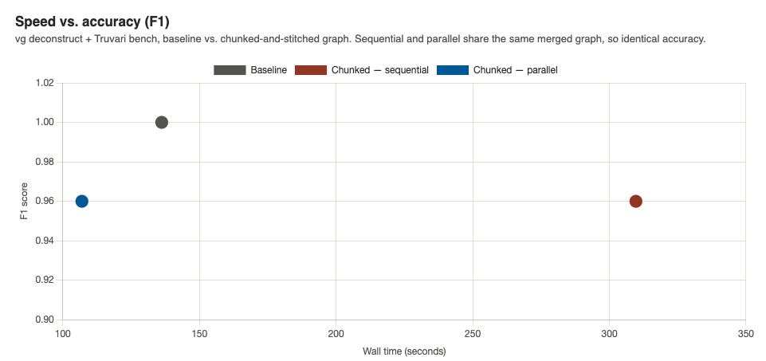
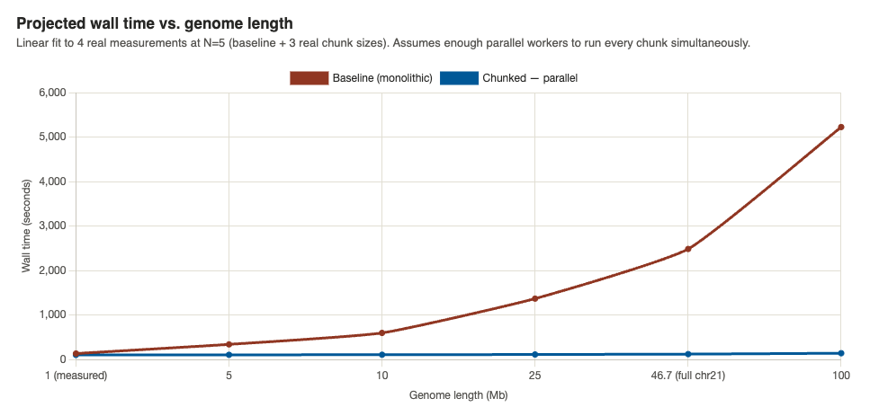

# Parallel Pangenome Graph Construction (Linear Scaling SV)

[](tests/)
[](https://web-lemon-zeta-40.vercel.app)
[](https://collaborativebioinformatics.github.io/linear-scaling-pangenome-sv/)
[]()

This repository builds PGGB pangenome graphs in parallel chunks, stitches the chunk graphs back into one graph, and compares the result with a monolithic PGGB build of the same region and haplotypes. On HPRC release 2 assemblies, chunks cut without overlap reproduce every haplotype path of the monolithic graph, and where the cuts fall matters little. In segmental duplications the chunked graphs score closer to assembly-based truth calls than the monolithic graph does.

> **Research question:** Can pangenome graphs be built in parallel chunks and stitched back together while preserving haplotype paths, topology, and variant representation compared to a monolithic build?

Live site: [collaborativebioinformatics.github.io/linear-scaling-pangenome-sv](https://collaborativebioinformatics.github.io/linear-scaling-pangenome-sv/) | [Vercel mirror](https://web-lemon-zeta-40.vercel.app)

## Contents

1. [Key findings](#key-findings)
2. [Quick start](#quick-start)
3. [How it works](#how-it-works)
4. [Experiments and reproducibility](#experiments-and-reproducibility)
5. [Web explorer](#web-explorer)
6. [Configuration](#configuration)
7. [DNAnexus](#dnanexus)
8. [Repository structure](#repository-structure)
9. [Current state](#current-state)
10. [Team](#team)
11. [License](#license)

## Key findings

### Where to cut: chunking experiments (Nov 2026)

These runs ask whether the place you cut a region changes the stitched graph. All are on the 4 vCPU cloud container with the pinned PGGB image (pggb commit 4225c6c, ghcr.io build of 2026-07-24), real HPRC release 2 assemblies, and GRCh38 chr21:20-21 Mb unless noted. Full write-ups are in `docs/`.

| Step | Question | Finding | Write-up |
|------|----------|---------|----------|
| Pilot | Do cuts at recombination hotspots (haploblocks.org) beat fixed 400 kb windows? | Hotspot chunks looked closer to monolithic (+14 bp of node sequence vs +4,723 bp) | [RECOMBINATION_CHUNKS.md](docs/RECOMBINATION_CHUNKS.md) |
| Tier 1 | Was that the hotspots, or the 50 kb overlap the windows had? | The overlap. Zero-overlap cuts anywhere (fixed, shifted or 20 random sets) leave no extra sequence at the seams, and hotspot cuts score at the random median (F1 0.9985 vs 0.9984). | [TIER1_CONTROLS.md](docs/TIER1_CONTROLS.md) |
| Tier 2 | Does that hold at more haplotypes and in segmental duplications? | Seams stay clean up to 40 haplotypes and fixed windows still match or beat hotspots. In 17q21.31 and 22q11.2, chunked graphs carry about 6.5% more sequence because paralogous copies land in different chunks. | [TIER2.md](docs/TIER2.md) |
| Tier 3 | Which graph is right where they disagree, do duplication-aware groups help, and what happens at 10 Mb? | Scored against assembly-based truth calls, chunked graphs match monolithic on chr21 (F1 0.98) and beat it in 22q11.2 (0.96 vs 0.88), because monolithic PGGB merges paralogous LCR22 copies. Grouping the chunks that share a duplication undoes that gain. PGGB's human settings (`-p 98 -s 10k -k 47`) reduce the merging but chunked graphs still score higher (0.94-0.97 vs 0.86-0.93). Two replicates agree. At 10 Mb, 1 Mb chunks cost 1.22x the CPU and stay under 1 GB each, against 2.8 GB monolithic. | [TIER3.md](docs/TIER3.md) |
| Tier 4 | Does chunking hold at chromosome scale, and against a curated truth set? | On 31 Mb of chr21 with 6 haplotypes, 29 hotspot chunks score the same as the monolithic graph (F1 0.976; HG002 0.980 against GIAB Q100) for 1.05x the CPU, at most 3.4 min and 0.97 GB per chunk against 49 min and 12.1 GB. At 20 and 40 haplotypes the monolithic build did not finish on a 16 GB runner, while chunks needed at most 1.5 and 3.0 GB; cost is 48 to 56 CPU-seconds per Mb per haplotype up to 20 haplotypes and 73 at 40. With HG002 added, chunked graphs still beat monolithic in 22q11.2 (0.965 vs 0.898) and 17q21.31 (0.80 vs 0.70) at `-p 90` and at `-p 98` (0.97 vs 0.94, 0.94 vs 0.85); against GIAB alone the 22q11.2 gap closes at `-p 98`. | [TIER4.md](docs/TIER4.md) |

What to take from it:

- **Cut without overlap.** Chunks that touch end to end stitch cleanly (`seam_position` joins touching intervals, and `project_chunks.py` projects each cut onto every haplotype so neighbours meet exactly). About 1 Mb per chunk is a good size. At 50-270 kb each PGGB run is mostly fixed cost, and at 10 Mb the CPU overhead falls from 1.51x with 400 kb chunks to 1.22x with 1 Mb and 1.06x with 2.5 Mb.
- **Where you cut matters less than we expected.** Recombination hotspots have not beaten fixed zero-overlap cuts in any comparison so far.
- **In segmental duplications, chunk boundaries help.** With `-p 90`, monolithic PGGB routes about 9% of each 22q11.2 haplotype through nodes it has already used (collapsed paralogs); zero-overlap chunks bring that to 2.4% and score closer to the truth set. Keeping paralogous chunks together in one job (the rule Tier 2 proposed) makes it worse, so don't.
- **Check monolithic VCFs in duplicated regions.** When a reference path loops through collapsed paralogs, `vg deconstruct` can put hundreds of kb of variants under one short top-level bubble, and PGGB's `vcfbub -l 0 -a 100000` drops them all: at `-p 98` the monolithic 22q11.2 VCF lost 86% of the truth calls. `pipeline/benchmark/tier3/path_revisits.py` shows the loops; scoring with `--bub "-l 0 -a 10000"` recovers the calls.
- **Chunking pays off around 40 haplotypes.** At N = 40 three chunks use the same total CPU as monolithic (1,790 vs 1,775 s), the longest chunk finishes in 40% of the monolithic wall time, and peak memory stays near 970 MB per chunk against 2.3 GB monolithic.
- **Replicate everything.** The pinned PGGB image is not deterministic: two monolithic builds of the same input differ by up to 9 nodes and 47 bp, which is the size of most effects above.
- **seqwish bug, fixed here.** The pinned PGGB build (commit 4225c6c) passes its default `-B 10M` to seqwish unparsed, so any input sequence over about 1 Mb comes out under-collapsed (22q11.2: 12.3 Mb of node sequence instead of 4.3 Mb). `config/pipeline.yaml` now sets `transclose_batch: 100000000` and every runner passes it; set `PGGB_TRANSCLOSE_BATCH=pggb-default` to get the old behaviour. The 1 Mb chr21 results are not affected.

The paper draft covers Tiers 1-4 and is in [docs/paper/manuscript.md](docs/paper/manuscript.md), with its five figures in [docs/paper/figures/](docs/paper/figures/) (regenerate with `python scripts/make_paper_figures.py`).

## Quick start

### Local demo (synthetic data, no DNAnexus or HPRC data needed)

```bash
git clone https://github.com/collaborativebioinformatics/linear-scaling-pangenome-sv.git
cd linear-scaling-pangenome-sv
pip install pyyaml pytest
make check           # Verify your environment
make demo            # Generate synthetic data, build GFAs, stitch, export web JSON
make test            # Run 204 tests
make web             # Start Next.js dev server at http://localhost:3000
```

To run the full pipeline on real HPRC data, see [DNAnexus](#dnanexus).

### Explore the real 1 Mb chr21 benchmark

[web-lemon-zeta-40.vercel.app](https://web-lemon-zeta-40.vercel.app) shows the real HPRC baseline in five tabs:

| Tab | Content |
|-----|---------|
| Explore | Interactive Cytoscape graph with color-coded shared/unique DNA |
| Results | 10,389 nodes, 14,185 edges |
| Chunks | 3 overlapping 400 Kb chunks |
| Compare | Compare any two people's DNA |
| Speed | Measured build time, monolithic vs longest chunk, at 1, 10 and 31 Mb, with a cost table |

## How it works

### Background

A pangenome graph stores the variation across many haplotypes in one data structure, instead of describing every genome as a list of differences from a single linear reference such as GRCh38. Linear comparisons collapse human diversity into one path, so structural variants are often missed or misrepresented in diverse or repetitive regions. A graph encodes divergent sequence as alternate nodes and paths, which captures large insertions, deletions and rearrangements directly.

This project builds on PGGB (the PanGenome Graph Builder). PGGB runs in three stages. It aligns all input haplotypes against each other to find homologous regions, induces a variation graph from those alignments by collapsing shared sequence into common nodes, and then smooths and normalizes the graph with partial-order alignment, so that locally linear regions are represented cleanly and true structural variation stays visible as bubbles. The output is one graph plus a path for each input haplotype, usable for variant calling, alignment and comparative analysis. The all-pairs alignment grows roughly quadratically (O(n²)) with the number of haplotypes, and alignment, induction and smoothing all run over the full length of the input, so cost also grows with region size. Large builds soon exceed the runtime and memory of typical compute infrastructure. The goal here is to get around that scaling as sample count and region length increase.

### Approach

The monolithic build is split into smaller independent problems that run in parallel and are then reassembled. minimap2 maps the target interval onto each haplotype, the interval is cut into chunks with matching coordinates on every haplotype, PGGB builds a graph for each chunk in parallel, and the chunk graphs are stitched across their boundaries into one graph.

The stitched graph is validated against a monolithic PGGB graph built the standard way over the same interval and haplotypes. The checks cover topology, whether each haplotype path stays intact and contiguous across chunk boundaries, sequence content, and variant representation. For variants, both graphs are called and the callsets compared with truvari (precision, recall, F1). An assembly-based linear-reference SV callset against GRCh38 gives a second comparison point outside the graph pipeline.

### Pipeline flow

```
HPRC Release 2 (4 haplotypes + GRCh38)
  -> minimap2 interval mapping
  -> monolithic PGGB (baseline)  OR  chunk PGGB (parallel)
  -> merge (overlap-aware stitch)
  -> validation & benchmark
  -> JSON -> web
```

Merge status: the overlap-aware stitch is on main (`pipeline/merge/merge_graphs.py`). `make demo` prints `Strategy: overlap_aware` and an EQUIVALENT 5-component graph. Disjoint union remains as a diagnostic strategy.

### Methods (pilot)

The pilot used four haplotype-resolved assemblies from HPRC Release 2 and GRCh38, restricted to a 1 Mb smoke-test interval on chr21 (chr21:20,000,000–21,000,000). Each haplotype assembly has its own coordinate system, so minimap2 first aligns each haplotype to GRCh38 and projects the interval boundaries onto the haplotype's own sequence, dropping mappings below MAPQ 20 or query coverage 0.90. samtools-based interval extraction and a custom multi-FASTA builder then produce the per-haplotype sequence for the interval. From this input two graphs are built. The monolithic baseline runs PGGB v0.6.0 once over the full interval and all haplotypes in Docker. The parallel graph cuts the same interval into overlapping 400 kb windows (50 kb pairwise overlap), extracts each haplotype's sub-sequence per chunk under a parent-locus constraint that rejects chunks spanning contig boundaries or with ambiguous strand orientation, and runs PGGB on each chunk independently with identical parameters. Local synthetic runs and real HPRC runs are orchestrated the same way: a Makefile drives local execution, and a matching set of DNAnexus applets and shell scripts stages inputs and launches the chunked and baseline jobs in the cloud.

Chunk graphs are handled with an in-house GFA data model and parser that supports the full GFA1 structure (headers, segments, links, paths, and the official W-line walk format) with round-trip parsing, serialization and file I/O. Reassembly has two strategies. A namespace-safe disjoint union concatenates chunk graphs without merging shared content and serves as a diagnostic baseline. The overlap-aware stitch, the project's core methodological contribution, finds each haplotype's common subpath in a chunk pair's overlap and welds matching segment IDs across the boundary into one continuous graph; a boundary report records per-haplotype stitch success and base-level identity at each seam. On synthetic data, `make demo` yields an EQUIVALENT 5-component graph with 2/2 boundaries passing. On HPRC release 2 data (chr21:20–21 Mb, 5 haplotypes, zero-overlap chunks), every haplotype path matches the monolithic build and truvari F1 against the monolithic callset is about 0.998 ([Tier 1](docs/TIER1_CONTROLS.md), [Tier 2](docs/TIER2.md)). Variants are called from both graphs with vg deconstruct and compared with truvari; the linear-reference SV callset for the same haplotypes is made with dipcall. A pytest suite (204 tests spanning the GFA model, chunking, merging, interval mapping and pipeline orchestration) covers the pipeline, and results are exported as compact JSON for a Next.js/React/TypeScript dashboard.

<br>

<br>

Full editable deck: [`slides/methods_results_slide.pptx`](slides/methods_results_slide.pptx)

## Experiments and reproducibility

### Where each experiment lives

| Step | Write-up | Scripts | Raw results |
|------|----------|---------|-------------|
| Pilot | [docs/RECOMBINATION_CHUNKS.md](docs/RECOMBINATION_CHUNKS.md) | `pipeline/parallel/hotspot_chunks.py`, `pipeline/prepare/project_chunks.py`, `pipeline/benchmark/compare_chunking.py` | [docs/recombination_chunks_comparison.json](docs/recombination_chunks_comparison.json) |
| Tier 1 | [docs/TIER1_CONTROLS.md](docs/TIER1_CONTROLS.md) | `pipeline/benchmark/run_tier1_controls.sh`, `pipeline/benchmark/seam_metrics.py` | [docs/tier1_controls.json](docs/tier1_controls.json) |
| Tier 2 | [docs/TIER2.md](docs/TIER2.md) | [pipeline/benchmark/tier2/](pipeline/benchmark/tier2/) | [docs/tier2.json](docs/tier2.json) |
| Tier 3 | [docs/TIER3.md](docs/TIER3.md) | [pipeline/benchmark/tier3/](pipeline/benchmark/tier3/) | [docs/tier3.json](docs/tier3.json), `docs/tier3_path_revisits_*.tsv` |
| Tier 4 | [docs/TIER4.md](docs/TIER4.md) | [pipeline/benchmark/tier4/](pipeline/benchmark/tier4/) | [docs/tier4_runs/](docs/tier4_runs/) |
| Tier 5 (running) | Write-up after the runs finish. Question: does an extra cut between two paralogous copies that share a chunk help, beyond a cut of the same size placed away from any paralog? | [pipeline/benchmark/tier5/paralog_cuts.py](pipeline/benchmark/tier5/paralog_cuts.py); manifests `r17/r22.{sdsplit,ctrl}.tsv` in `pipeline/benchmark/tier4/manifests/`; stage `tier4-cuts` | `docs/tier4_runs/tier4_cuts_*.json`, [docs/tier5/](docs/tier5/) (paralog pairs) |

Each write-up lists the commands it was run with.

### Pilot benchmark on DNAnexus (Aug 28 2026)

| Metric | Value |
|--------|-------|
| Region | GRCh38 chr21:20,000,000–21,000,000 (1,000,000 bp) |
| Haplotypes | 5 (GRCh38 + HG00673/733 paternal+maternal) |
| Baseline nodes | 10,389 |
| Baseline edges | 14,185 |
| Baseline wall time | 327s (5.5 min) on `mem3_ssd1_v2_x16` |
| Parallel wall time | 272s (4.5 min), 1.20× speedup |
| PGGB | commit 4225c6c (ghcr.io build of 2026-07-24; not the v0.6.0 release), pinned `sha256:44f3563c`, -K 19, -k 29 |
| Chunk status | ✅ Rebuilt Nov 2026 with zero-overlap chunks projected onto every haplotype ([Tier 1](docs/TIER1_CONTROLS.md)) |
| Stitch / Truvari | ✅ Every haplotype path identical to the monolithic build; truvari F1 ≈ 0.998 vs monolithic ([Tier 1](docs/TIER1_CONTROLS.md), [Tier 2](docs/TIER2.md)) |

<br>


- [Speed comparison](slides/speed_comparison.html): monolithic vs. chunked, sequential vs. parallel
- [Speed vs. accuracy](slides/speed_vs_accuracy.html): F1 against wall time
- [Scaling by sample count](slides/scaling_by_sample_count.html): projected, O(N²) model
- [Scaling by genome length](slides/scaling_by_genome_length.html): projected, linear fit to real data

### Running the long experiments on GitHub

The Tier 3 runs take hours. `.github/workflows/experiment.yml` runs them on a GitHub runner: open the Actions tab, pick **Experiment**, choose a stage (`tier3-e1e2`, `tier3-e4` or `tier3-scaling`) and a branch, and the JSON, TSV and log outputs come back as an artifact. Tier 4 fans out instead: stage `tier4-arm` (input `n` = 6, 20 or 40) or `tier4-hard`, with `pggb` = `p90` or `p98` and a replicate label, runs one job per sample, one per chunk and one per graph, and commits a summary JSON to `docs/tier4_runs/` when the branch is a `claude/` branch. Stage `tier4-cuts` (Tier 5) builds mono, windows0, sdsplit and ctrl for 17q21.31 and 22q11.2 at 6 haplotypes, with the same `pggb` and replicate inputs.

### haploblocks.org data and the AWS kit

[data.haploblocks.org](https://data.haploblocks.org) splits each 1000 Genomes chromosome (2,548 samples, 5,096 haplotypes) into blocks between recombination hotspots. The sequences are VCF-derived consensus, so they carry few SVs, but many haplotypes in a block are identical. `pipeline/haploblocks/prepare_block.py --dedupe` keeps one copy of each, which on a 4.6 kb chr22 block cut 5,096 haplotypes to 318 sequences and gave the same graph 3.5-5x faster. Blocks this short need `-s 1000` (`config/haploblocks.yaml`); the default `-s 5000` fails below 5 kb. `aws/` holds an AWS Batch (Spot) stack that runs one block per array task; see [aws/README.md](aws/README.md) for the steps and cost controls.

## Web explorer

The web explorer is a Next.js + React + TypeScript app that renders graphs with Cytoscape.js.

```bash
cd web
npm ci          # install dependencies
npm run dev     # start dev server at http://localhost:3000
npm run build   # production build
```

### Data architecture

```
DNAnexus / local GFA results
   │  (offline, never sent to browser)
   ▼
pipeline/export/build_web_dataset.py
   │  bounded compact JSON (no sequences, no GFA/FASTA/VCF)
   ▼
results/web/{manifest.json, overview.json, graphs/...}
   │  scripts/sync_web_results.py (guards genomic + size)
   ▼
web/public/data/
   │
   ▼
Next.js + Cytoscape.js explorer
```

- `manifest.json`: sample/haplotype discovery, pipeline status, graph metrics.
- `overview.json`: chunk coordinate windows.
- `graphs/<graph>/<sample>_<hap>.json`: bounded per-haplotype subgraph (selected path + one-hop branches). It holds node ids, lengths, degree, and path/reference membership only, with no nucleotide sequences.

### Sample selection

Select a sample (GRCh38, HG00673, HG00733) and haplotype (reference / paternal / maternal). Each selection lazy-loads only its compact JSON. The explorer supports graph selection (Baseline vs Merged), zoom/pan, fit/reset, node search, a node/edge inspector, and reference/branch highlighting.

### Deploy

```bash
cd web
npx vercel --prod
```

Only static compact JSON is served; no DNAnexus credentials or raw genomics files reach the browser.

## Configuration

| Parameter | File | Default | Description |
|-----------|------|---------|-------------|
| target.chromosome | config/pipeline.yaml | chr21 | Target chromosome |
| target.start/end | config/pipeline.yaml | 20000000-21000000 | Smoke interval (0-based half-open) |
| mapping.min_query_coverage | config/pipeline.yaml | 0.90 | Minimum query coverage |
| mapping.min_mapq | config/pipeline.yaml | 20 | Minimum MAPQ |
| parallel.chunk_size_bp | config/pipeline.yaml | 400000 | Chunk size in bp |
| parallel.overlap_bp | config/pipeline.yaml | 50000 | Pairwise overlap between chunks |
| pggb.threads | config/pipeline.yaml | 8 | PGGB thread count |
| pggb.params.transclose_batch | config/pipeline.yaml | 100000000 | seqwish `-B`; must exceed the total input bp (see docs/TIER2.md) |
| pggb.params.segment_length | config/haploblocks.yaml | 1000 | `-s` for haploblocks.org blocks, which can be under 5 kb |

## DNAnexus

Real HPRC runs use two applets, `pggb_chunk` and `pggb_baseline`, on instance type `mem3_ssd1_v2_x16`. Operations details are in [docs/DNANEXUS.md](docs/DNANEXUS.md).

```bash
# Inside DNAnexus Cloud Workstation:
cd ~/pangenome-parallel
git pull origin main
bash dnanexus/setup_workstation.sh   # One-time setup
bash dnanexus/run_pipeline.sh --upload  # Full pipeline
```

## Repository structure

```
pangenome-parallel/
|-- config/               # Pipeline configuration (YAML)
|-- pipeline/prepare/faidx_utils.py  # samtools interval extraction
|-- pipeline/prepare/map_chromosome.py  # minimap2 interval mapping
|-- pipeline/prepare/prepare_sequences.py  # Multi-FASTA builder
|-- pipeline/prepare/project_chunks.py  # Project reference cuts onto each haplotype
|-- pipeline/parallel/make_chunks.py  # Overlapping chunk creation
|-- pipeline/parallel/build_all_chunks.py  # Chunk FASTA builder
|-- pipeline/parallel/hotspot_chunks.py  # Zero-overlap chunks cut at recombination hotspots
|-- pipeline/baseline/build_baseline.sh  # Monolithic PGGB via Docker
|-- pipeline/merge/gfa.py         # GFA data model (core library)
|-- pipeline/merge/merge_graphs.py  # Merge strategies
|-- pipeline/benchmark/           # Stats, path compare, reports
|-- pipeline/benchmark/compare_chunking.py  # Monolithic vs chunked: topology, paths, variants
|-- pipeline/benchmark/seam_metrics.py  # Extra sequence and errors by distance to a cut
|-- pipeline/benchmark/tier2/      # Tier 2 scaling, hard-region and map scripts
|-- pipeline/benchmark/tier3/      # Tier 3 truth set, scoring, SD groups, 10 Mb and replicate scripts
|-- pipeline/benchmark/tier4/      # Tier 4 chr21 arm and HG002/GIAB kit: manifests, projection, fan-out build and scoring
|-- pipeline/export/build_web_dataset.py  # GFA -> bounded web JSON (A6)
|-- pipeline/haploblocks/prepare_block.py  # haploblocks.org block -> PanSN FASTA, optional dedupe
|-- scripts/run_pggb.py           # Canonical PGGB runner (reads config)
|-- scripts/fetch_hprc_index.py  # Official HPRC Release 2 index
|-- scripts/download_hprc.py     # Download with gzip validation
|-- scripts/prepare_reference.sh  # GRCh38 chr21 from DNAnexus/NCBI
|-- scripts/setup_demo.py        # Synthetic end-to-end demo
|-- scripts/check_environment.sh  # Tiered environment checker
|-- .github/workflows/experiment.yml  # Long benchmark runs on a GitHub runner (manual dispatch)
|-- dnanexus/applets/pggb_chunk/  # PGGB applet for parallel chunks
|-- dnanexus/applets/pggb_baseline/  # PGGB applet for baseline
|-- dnanexus/run_pipeline.sh      # Master orchestrator
|-- dnanexus/run_parallel_chunks.sh  # Launch chunk jobs on DNAnexus
|-- dnanexus/stage_inputs.sh      # Stage HPRC assemblies from storage
|-- dnanexus/setup_workstation.sh  # Bootstrap Cloud Workstation
|-- aws/                          # AWS Batch kit for haploblocks.org blocks
|-- web/                         # Next.js + React + TypeScript
|-- docs/                        # Architecture, methods, DNAnexus, chunking experiments
|-- docs/tier4_runs/               # One JSON per Tier 4 GitHub run, committed by the workflow
|-- tests/                       # 204 tests, pytest
```

## Current state

`python3 -m pytest -q` reports 204 passed.

| Component | Status | Notes |
|-----------|--------|-------|
| GFA data model | ✅ | Header, Segment, Link, Path, Walk (official W-line, no step_count) |
| GFA parser | ✅ | Parse, dump, roundtrip, file I/O |
| Chunking | ✅ | Overlapping chunks, configurable pairwise overlap; zero-overlap hotspot chunks (`hotspot_chunks.py`) |
| Per-haplotype cut projection | ✅ | `project_chunks.py`: chained minimap2 alignment, same cut on every haplotype |
| Merge (disjoint union) | ✅ | Namespace-safe concatenation, diagnostic only |
| Overlap-aware stitch | ✅ | `overlap_aware_stitch()`; `make demo` EQUIVALENT, 5 components |
| Synthetic demo | ✅ | `make demo` generates full vertical slice |
| Tests | ✅ | GFA, chunking, merge (`tests/test_merge.py`), PGGB config, web dataset export, interval mapping, W-line, provenance, graph stats, hotspot chunks, cut projection, touching-chunk stitch, haploblocks, Tier 4 manifests and projection; 204 pass |
| Web explorer | ✅ Interactive | Cytoscape.js graph, sample/haplotype selector, inspector, 4 tabs, real JSON loading |
| Web dataset export | ✅ | `pipeline/export/build_web_dataset.py`: GFA → bounded compact JSON (no sequences) |
| Web JSON guard | ✅ | `guard_no_genomic()` blocks GFA/FASTA/VCF/BAM/CRAM; `WEB_MAX_FILE_MB` size guard |
| DNAnexus applets | ✅ Built | `pggb_chunk` + `pggb_baseline`, instance `mem3_ssd1_v2_x16` |
| DNAnexus dry-run | ✅ | 3 chunks validated, FATAL checks verified |
| Graph statistics | ✅ | Full topology, comparison, TSV export |
| Environment checker | ✅ | Pipeline-tiered: REQUIRED / CONTAINER / WEB_OPTIONAL |
| Stitch boundary validation | ✅ | `results/merge/boundary_report.tsv`; per-haplotype PASS/FAIL |
| Equivalence validation | ✅ | `make demo` EQUIVALENT; 1 Mb HPRC windowed stitch EQUIVALENT; independent zero-overlap chunk builds on HPRC chr21:20-21 Mb keep every haplotype path identical to monolithic ([Tier 1](docs/TIER1_CONTROLS.md)) |
| Variant comparison | ✅ | `vg deconstruct` + truvari; F1 ≈ 0.998 vs monolithic ([Tier 1](docs/TIER1_CONTROLS.md), [Tier 2](docs/TIER2.md)); truth-set scoring in [Tier 3](docs/TIER3.md) and [Tier 4](docs/TIER4.md) |

## Team

| Person | Primary area |
|--------|-------------|
| Nhat Quang Tran | Pipeline architecture + graph merging |
| Michael Olufemi | Pangenome graph construction |
| Dang Khoi Vu | Pipeline + linear/assembly workflow |
| Ali Rizvi | Pipeline + DNAnexus + integration + web |
| Alexander W. Lehr | Documentation + presentation |
| Lex | PGGB benchmarking |

Paper authors, in order: Nhat Quang Tran, Dang Khoi Vu, Michael Olufemi, Alexander W. Lehr, Ali Rizvi ([docs/paper/manuscript.md](docs/paper/manuscript.md)). The pipeline is a shared technical responsibility; everyone implements and troubleshoots it. The original hackathon task plan (who did what, pre-submission tasks, timeline, stitch algorithm notes and submission checklist) is kept in [docs/HACKATHON_PLAN.md](docs/HACKATHON_PLAN.md), with the full task breakdown in [docs/TASK_BREAKDOWN.md](docs/TASK_BREAKDOWN.md).

## License

MIT, see [LICENSE](LICENSE).

GitHub: https://github.com/collaborativebioinformatics/linear-scaling-pangenome-sv
